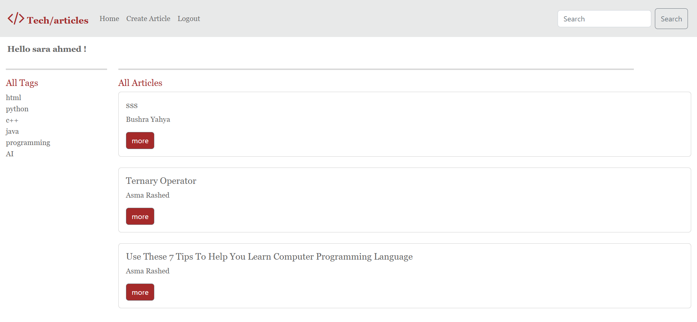
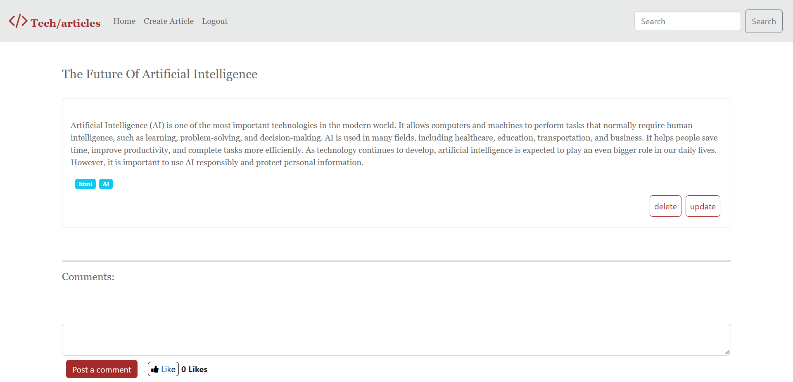
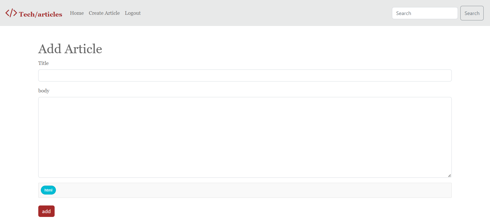

# TechArticle

A small blog platform for technical articles, built with **Python and Django**. Users register, publish articles with tags, comment on them and like them. It was my final project for the Python track, and I later reviewed and improved it for security and reliability.

Built with **Python, Django 5, SQLite, bcrypt, Bootstrap 5 and Font Awesome**.

## Features

- Register and log in (passwords are hashed with bcrypt)
- Dashboard with all articles, newest first
- Write articles with comma-separated tags
- Edit and delete your own articles
- Comment on articles
- Like and unlike articles, with a like counter
- Browse articles by tag
- Search articles by title

## Screenshots

### Dashboard
All articles, newest first, with their tags. The search box at the top finds articles by title.



### Article page
Read an article, add comments and like it. The author also sees **update** and **delete** buttons.



### Create an article
Write a title and text and add comma-separated tags.




## What I improved

I revisited this project after finishing the bootcamp and fixed the main problems:

- **Access control:** only the author can edit or delete an article. Delete works only through a POST request with a CSRF token.
- **Login required:** every page that needs a user sends visitors who are not logged in to the login page (a small `login_needed` decorator).
- **No more crashes:** wrong ids return a 404 page, and opening POST-only URLs directly redirects instead of raising an error.
- **Accounts:** the same email can't register twice (the check ignores upper and lower case), and the session id is renewed at login and registration.
- **Settings:** `SECRET_KEY` and `DEBUG` are read from environment variables.
- **Clean repository:** removed the database file and cache files from Git, added `.gitignore`, and a new `requirements.txt` with only the packages the project uses.

## Run it locally

You need Python 3.10 or newer.

```bash
git clone https://github.com/asma-rashed/TechArticle.git
cd TechArticle/TechArticle-main

python -m venv venv
venv\Scripts\activate          # Windows
# source venv/bin/activate     # macOS / Linux

pip install -r requirements.txt
python manage.py migrate
python manage.py runserver
```

Open `http://127.0.0.1:8000/` and register a new account.

Optional settings (environment variables):

| Variable | Meaning | Default |
| --- | --- | --- |
| `DJANGO_SECRET_KEY` | Django secret key | a development key |
| `DJANGO_DEBUG` | `True` or `False` | `True` |

Use your own `DJANGO_SECRET_KEY` and set `DJANGO_DEBUG=False` for anything other than local testing.

## Project structure

| Path | Purpose |
| --- | --- |
| `manage.py` | Django command line (`runserver`, `migrate`, ...) |
| `finalDjango_project/` | Project settings and main URL file |
| `final_app/models.py` | `Users`, `Articles`, `Tags`, `Comment` and `Like` models and form validation |
| `final_app/views.py` | The logic of each page |
| `final_app/urls.py` | Maps addresses to views |
| `final_app/templates/` | HTML pages |
| `final_app/static/` | CSS and images |

## Author

Asma Rashed, [github.com/asma-rashed](https://github.com/asma-rashed)
